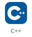
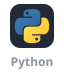
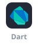
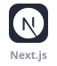
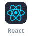
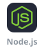
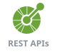
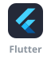
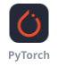
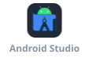

<picture><source media="(prefers-color-scheme: dark)" srcset="https://github.com/MeeLn/MeeLn/raw/main/assets/heading/title-dark.svg" /></picture>

🎓 BE in Information Technology  
💻 Passionate about software development, problem-solving & exploring new tech.

  

<picture><source media="(prefers-color-scheme: dark)" srcset="https://github.com/MeeLn/MeeLn/raw/main/assets/heading/tech-stack-dark.svg" /></picture>

**Languages**

**Web & Backend**

**Mobile**

**Data & AI**

**Tools**

<picture><source media="(prefers-color-scheme: dark)" srcset="https://github.com/MeeLn/MeeLn/raw/main/assets/heading/github-stats-dark.svg" /></picture>

  

  
  

  
  

<picture><source media="(prefers-color-scheme: dark)" srcset="https://github.com/MeeLn/MeeLn/raw/main/assets/heading/connect-dark.svg" /></picture>

⭐ From [Milan Raut](https://github.com/MeeLn)
